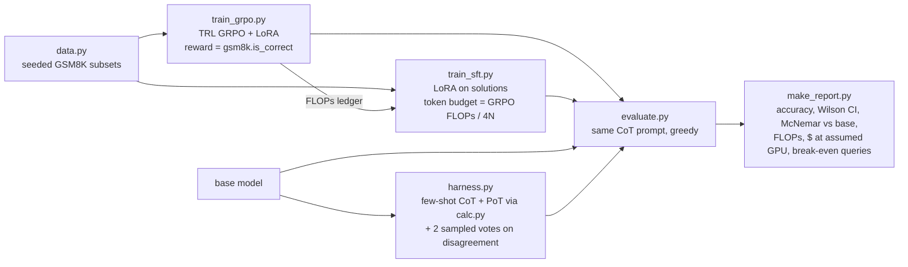

# rlvr-vs-sft-vs-harness

A compute-matched comparison of three ways to make a small model better at grade-school math
(GSM8K), on Qwen2.5-0.5B-Instruct:

- **(a) RLVR**: GRPO with a verifiable reward (the answer matches the gold number), via TRL + LoRA.
- **(b) SFT**: LoRA fine-tuning on reference solutions, stopped when its FLOPs equal the GRPO run's.
- **(c) Harness**: no training. Few-shot prompting, a program-of-thought answer run through a safe
  calculator tool, and a self-check vote when the two disagree.

> **Status: pipeline built and tested; the full comparison has NOT been run yet.** There are no
> accuracy results in this repo. The only measured artifact is a 2-step GRPO trial run
> (`results/smoke_grpo_2step.json`). The full run was attempted twice on this Mac. Both attempts
> stalled under memory pressure: about 15 GB of swap was in use by parallel jobs on the 16 GB machine.
> See *Results* and *Limits*.

## Why

"Should we do RL, SFT, or just build a better harness?" is a common question about small models. The
answer depends on compute, and most comparisons don't hold compute fixed. This repo counts FLOPs for
all three conditions, matches the two training runs to each other, and asks after how many queries
the harness's extra inference cost exceeds a one-time training cost.

## Architecture



## How it works

- **Verifiable reward** (`rvsh/gsm8k.py`, `rvsh/rewards.py`): extract the final number (`The answer is N`
  > `\boxed{N}` > `#### N` > last number), then compare it numerically to the gold `#### N`. A small
  format reward (0.1) is given for the answer line.
- **Compute ledger** (`rvsh/compute.py`): N = non-embedding parameters (357.9 M). Inference costs 2N
  per token. LoRA training costs 4N per token (frozen weights skip weight-gradient matmuls). Each GRPO
  sampled token costs 8N (generate + logprob + LoRA forward/backward). Dollar figures assume an A100
  at 100 effective TFLOP/s and $2/h. That price is an assumption and is labeled as one everywhere.
- **SFT matching** (`scripts/train_sft.py`): reads the GRPO FLOPs and trains on GSM8K train solutions
  (a pool disjoint from the GRPO prompts) until it has used the same FLOPs.
- **Harness** (`rvsh/harness.py`): few-shot CoT plus a program-of-thought answer. The program runs
  through `rvsh/calc.py`, an AST-whitelisted calculator with no imports, calls, attributes or huge
  exponents. If the two answers agree, the answer is kept. If not, 2 sampled CoT votes are drawn and
  the majority wins; on a tie the program's answer wins. All extra tokens count toward its inference cost.
- **Evaluation**: every condition uses the same system prompt on the same seeded test subset. The
  report gives Wilson 95% CIs and an exact McNemar test vs base on paired items.

```bash
make setup
make test                      # 19 tests, < 1 s, no model needed
STEPS=16 N=100 make reproduce  # GRPO -> matched SFT -> 4 evals -> results/summary.md
```

## Results

**No comparison results yet.** `make reproduce` has not completed on this machine.

What was measured, from `results/smoke_grpo_2step.json` (a pipeline check, not a result):

| run | prompts | sampled tokens | train-batch correctness (step 1 → 2) | estimated FLOPs | wall time (this Mac, MPS) |
|---|---|---|---|---|---|
| GRPO, 2 steps, 6 generations/prompt, LoRA r=16 | 4 | 7,722 | 33.3% → 33.3% | 2.21 × 10¹³ | 148 s |

This shows the TRL GRPO + LoRA + verifiable-reward loop runs end to end on Apple silicon, and the
compute ledger records it. Two steps cannot show learning, and none is claimed.

## Limits

- **The main experiment is not done.** Accuracy, compute-matched deltas and break-even figures will
  exist only after `make reproduce` finishes. The defaults are 16 GRPO steps × 2 prompts × 6 samples
  and 100 test questions. That is very small scale on purpose, because of the hardware.
- Even when run, a 0.5B model on 100 questions gives wide confidence intervals (about ±10 pp). A
  16-step GRPO run is far below what published RLVR results use.
- The FLOP counts are standard estimates. They ignore attention FLOPs and generation inefficiency.
  The dollar costs depend on the assumed GPU price, not on a measured bill.
- The harness tool is a restricted arithmetic evaluator, not a general Python sandbox.
- Training needs about 4 GB of free unified memory. On a busy 16 GB Mac it stalls in swap.
